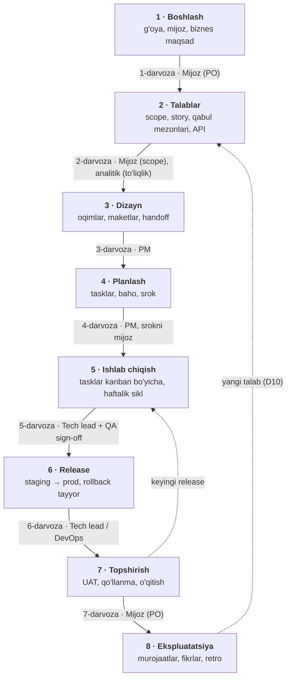
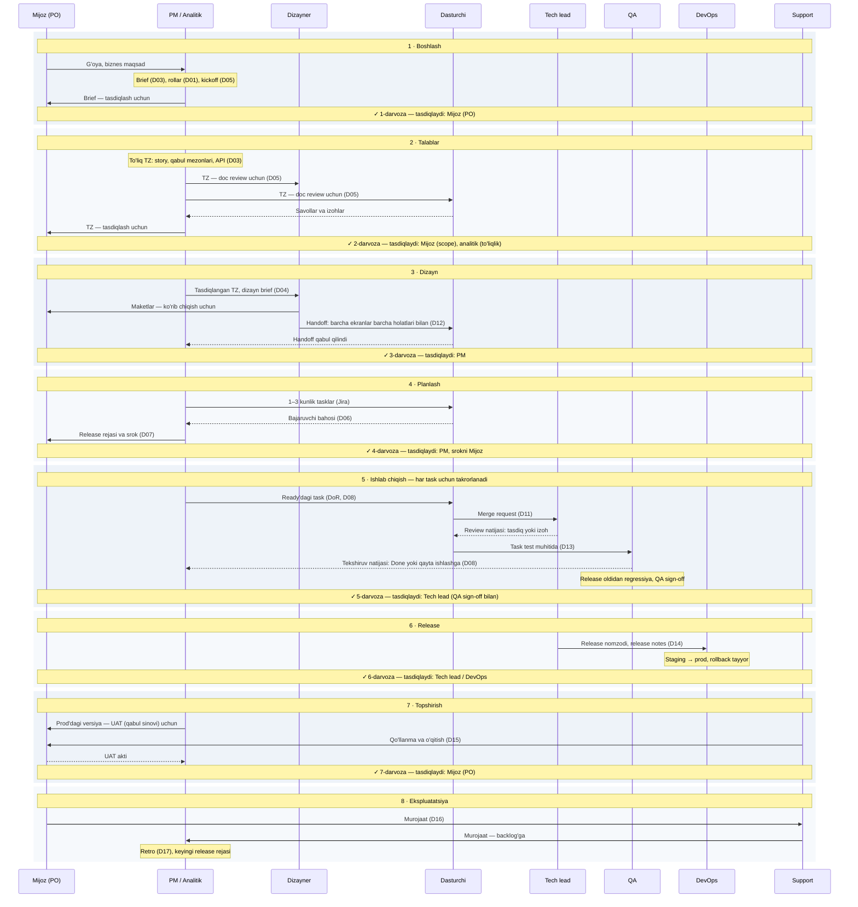
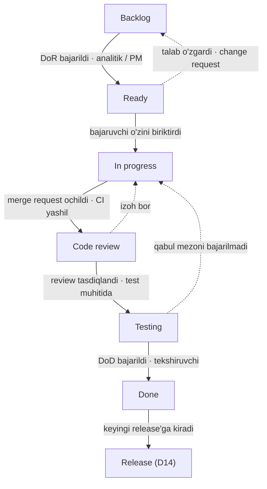

# Jarayon xaritasi

Butun standart uchta sxemada: loyiha qaysi bosqichlardan o'tadi, kim kimga nima topshiradi va bitta task qanday yo'l bosadi. Docni ochishdan oldin shu yerdan o'zingiz turgan joyni toping.

Jadvallardagi yozilgan doclar havola bo'lib turadi. Hali yozilmaganlari oddiy matn bilan yozilgan, ularning tavsifi root docdagi katalogda.

## 1. Loyiha bosqichlari va darvozalar

Loyiha 8 bosqichdan o'tadi. Keyingi bosqichga faqat darvozadan (bosqich oxiridagi tekshiruvdan) o'tgandan keyin o'tiladi. Strelkadagi yozuv — darvozani kim tasdiqlaydi. Batafsil kirish, chiqish va checklistlar — [D02](D02-loyiha-hayot-sikli.md).

Har bosqichda qaysi doc kerak:

| Bosqich | Doclar |
|---|---|
| 1 · Boshlash | [D03](D03-loyiha-boshlangich-hujjati.md) — Brief qismi; [D02](D02-loyiha-hayot-sikli.md) — bosqichlar rejasi, qarorlar jurnali va risklar reestri ochiladi; [D01](D01-rollar-va-raci.md) — rollar; [D05](D05-kickoff-va-doc-review.md) — kickoff |
| 2 · Talablar | [D03](D03-loyiha-boshlangich-hujjati.md) — to'liq TZ; [D05](D05-kickoff-va-doc-review.md) — doc review |
| 3 · Dizayn | [D04](D04-dizayn-brief-va-jarayon.md) — dizayn brief va jarayon; [D12](D12-ui-ux-standartlari.md) — UI/UX standartlari va handoff |
| 4 · Planlash | [D06](D06-baholash-va-srok.md) — baholash va srok; [D07](D07-taqsimot-va-resurs.md) — taqsimot va resurs |
| 5 · Ishlab chiqish | [D08](D08-kanban-dor-dod.md) — kanban, DoR, DoD; [D11](D11-dasturchilar-qoidalari.md) — kod va review; [D13](D13-test-strategiyasi.md) — test; [D12](D12-ui-ux-standartlari.md) — UI tekshiruvi; [D09](D09-meetinglar-ritmi.md) — meetinglar; [D10](D10-ozgarishlarni-boshqarish.md) — o'zgarishlar |
| 6 · Release | [D14](D14-release-va-deploy.md) — release va deploy |
| 7 · Topshirish | [D15](D15-qollanma-va-oqitish.md) — qo'llanma va o'qitish |
| 8 · Ekspluatatsiya | D16 — support va fikr yig'ish; [D17](D17-retro-va-standartni-yangilash.md) — retro |

Sxemada uzuq chiziq bilan ikkita qaytish yo'li ko'rsatilgan:

- **Release sikli.** Loyiha bir nechta release'ga bo'linadi. Har release 5–7 bosqichlardan alohida o'tadi.
- **O'zgarish.** Tasdiqlangan scope o'zgarsa, faqat o'zgargan qism 2-bosqichga qaytadi va 2–4 darvozalardan qayta o'tadi ([D10](D10-ozgarishlarni-boshqarish.md)).

Retro ([D17](D17-retro-va-standartni-yangilash.md)) har bosqich oxirida va loyiha oxirida o'tkaziladi; u sxemada alohida strelka bilan ko'rsatilmagan.

## 2. Kim kimga nima topshiradi

Har bosqichda kim ishlaydi va natijani kimga beradi. Kichik jamoada bir odam bir nechta rolni bajaradi: masalan, PM va analitik bitta odam; QA bo'lmasa, "QA" chizig'idagi tekshiruvni task muallifi bo'lmagan odam qiladi ([D08](D08-kanban-dor-dod.md)).

Sxemani qanday o'qish kerak (yuqoridan pastga, vaqt bo'yicha):

- **Vertikal chiziq** — rol.
- **To'liq strelka** — kim kimga nima topshiradi. Strelka chapga yoki o'ngga qarashi faqat rollarning joylashuviga bog'liq, orqaga qaytish emas.
- **Uzuq strelka** — javob: izoh, baho, tekshiruv natijasi.
- **Rol ustidagi yozuv** — shu rolning o'zi bajaradigan ish.
- **"✓ N-darvoza" qatori** — bosqich tugadi, kim tasdiqlaydi; shundan keyingina keyingi bosqich boshlanadi.

## 3. Bitta taskning yo'li

5-bosqich ichida har task board ustunlari bo'ylab yuradi. Strelkadagi yozuv — keyingi ustunga o'tish sharti va uni kim o'tkazadi. Batafsil: ustunlar va DoR/DoD — [D08](D08-kanban-dor-dod.md), merge request va review — [D11](D11-dasturchilar-qoidalari.md), testlar — [D13](D13-test-strategiyasi.md), release — [D14](D14-release-va-deploy.md).

Uzuq chiziqli qaytish strelkalari — rework. Ularning soni retroda sanaladi ([D17](D17-retro-va-standartni-yangilash.md)). Testing'dan qaytgan task yangi task bo'lib emas, izoh bilan In progress'ga qaytadi.

## Qaysi savolga qaysi doc

| Savol | Doc |
|---|---|
| Loyiha qaysi bosqichda, keyingisiga o'tsak bo'ladimi? | [D02](D02-loyiha-hayot-sikli.md) |
| Qaror qayerda yozilgan, nega shunday qilgandik? | [D02](D02-loyiha-hayot-sikli.md) — qarorlar jurnali |
| Mijoz nima so'ragan, scope'ga nima kiradi? | [D03](D03-loyiha-boshlangich-hujjati.md) |
| Maket qanday tartibda chiziladi va dasturchiga qanday beriladi? | [D04](D04-dizayn-brief-va-jarayon.md) (brief → wireframe → UI → handoff); nima bilan chiziladi — [D12](D12-ui-ux-standartlari.md) |
| Foydalanuvchi uchun qo'llanma va o'qitish qanday bo'ladi? | [D15](D15-qollanma-va-oqitish.md) |
| Retro qachon va qanday o'tadi, standart qanday o'zgaradi? | [D17](D17-retro-va-standartni-yangilash.md) |
| Qaysi meetinglar bor, meeting qanday o'tadi va natijasi qayerga yoziladi? | [D09](D09-meetinglar-ritmi.md) |
| TZ'ni qanday ko'rib chiqamiz, savollar qayerga yoziladi? | [D05](D05-kickoff-va-doc-review.md) |
| Srok qanday belgilanadi, surilsa nima qilinadi? | [D06](D06-baholash-va-srok.md) |
| Taskni ishga olsa bo'ladimi, tugadimi? | [D08](D08-kanban-dor-dod.md) — DoR va DoD |
| Branch, commit, merge request, review qanday? | [D11](D11-dasturchilar-qoidalari.md) |
| Qanday test yoziladi va kim tekshiradi? | [D13](D13-test-strategiyasi.md) |
| Prod'ga qanday chiqariladi va qanday qaytariladi? | [D14](D14-release-va-deploy.md) |
| Modul kimda, u yo'q bo'lsa kim qiladi? Yangi odam qanday ulanadi? | [D07](D07-taqsimot-va-resurs.md) |
| Kim nimaga javobgar? Rol bo'sh bo'lsa kim qiladi? | [D01](D01-rollar-va-raci.md) — rollar, RACI, kichik jamoada birlashtirish |
| Talab o'rtada o'zgarsa yoki mijoz yangi narsa so'rasa nima qilinadi? | [D10](D10-ozgarishlarni-boshqarish.md) |

---

Egasi: PM · Oxirgi yangilangan: 2026-11-07 · Keyingi ko'rib chiqish: har yangi doc yozilganda (jadvallardagi doc holati yangilanadi)
